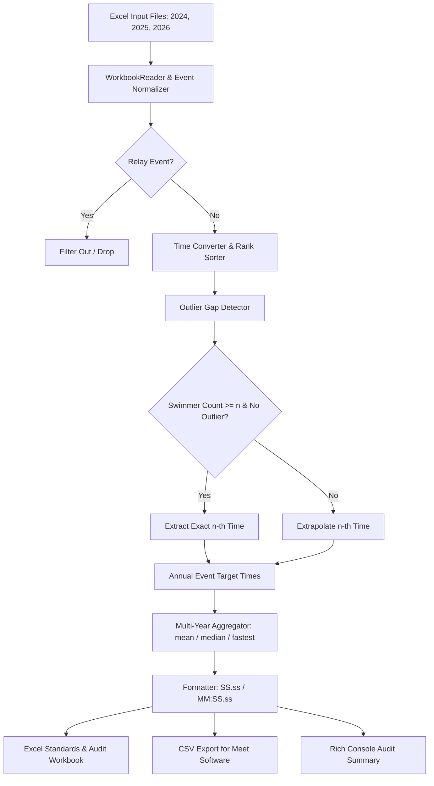

# Requirements

### Overview & Goals
The objective is to establish an equitable, data-driven, and repeatable system for generating regional swimming qualifying standards for Intermediate School Sports (Year 7 and Year 8 Boys and Girls). 

To maximize the collective utility of the athletic program—balancing broad participation opportunities, athlete welfare, and competitive integrity—the system processes historical championship meet results from 2024, 2025, and 2026 to derive reliable cutoff times based on the 8th-place benchmark (or an arbitrary $n$-th rank). The solution is packaged as a reusable command-line interface (CLI) script capable of being re-executed across future seasons or other regional data archives.

### Scope
- **In Scope**:
  - Processing historical workbook files (`wbop2024-top8.xls`, `wbop2025-top8.xls`, `wbop2026-top8.xls`) across Year 7 and Year 8 Girls and Boys.
  - Automated normalization of diverse sheet layouts, column offsets, and time formatting variants.
  - Outlier detection to filter severe drop-offs/blowouts between consecutive swimmers.
  - Algorithmic extrapolation of $n$-th place qualifying marks when fewer than $n$ swimmers competed or when late results represent uncompetitive drop-offs.
  - Multi-year combination with configurable aggregation operators (`average`, `median`, `fastest`).
  - Configurable $n$-th target position (defaulting to 8th, with support for any arbitrary rank like 10th).
  - Configurable flags with pre-set defaults for extrapolation mode, combination strategy, outlier gap thresholds, and output paths.
  - Automated generation of structured Excel workbooks (standards sheet + audit diagnostic trace) and machine-readable CSV files.
- **Out of Scope**:
  - Relay events (Events 17 & 18) are excluded from qualifying standard calculations as instructed, since they represent team aggregate scores rather than individual qualifications and were only contested in 2026.
  - Direct database synchronization or remote network fetching.

### User Stories
- **As a Meet Director**, I want to generate equitable qualifying standards derived from multi-year empirical performance so that heats are evenly distributed, races remain competitive, and pool session time is maximized without arbitrary exclusions.
- **As a School Coach**, I want transparent audit diagnostics showing how each event standard was calculated (and whether any time was mathematically extrapolated) so that my student athletes and parents trust the qualification threshold.
- **As a Regional Sports Coordinator**, I want a reusable CLI script that I can run year after year on newly updated meet files with simple flags to adjust qualifying parameters without touching source code.

### Functional Requirements
1. **Input Ingestion & Robust Parsing**:
   - Ingest Excel workbooks formatted in BIFF8 (`.xls`) format across 2024, 2025, and 2026.
   - Reliably parse swimmer records across inconsistent row/column layouts (e.g., 2024/2025 compact tables vs. 2026 wide column-shifted tables).
   - Accurately parse standard swimming times across formats: `M:SS.ss`, `SS.ss`, tied places (`*1`, `*2`), and ignore non-finishers (`DQ`, `DNF`, `SCR`).
2. **Event Scope & Relay Exclusion**:
   - Identify all individual events spanning Year 7 and Year 8, Boys and Girls, across all strokes (Breaststroke, Butterfly, Backstroke, Freestyle, Individual Medley) and distances (25m, 50m, 100m).
   - Automatically detect and filter out relay events (e.g., Freestyle Relays) from standard calculations.
3. **Outlier Detection & Gap Criteria**:
   - For any event with $k$ recorded finishers, calculate step differentials $\Delta_i = T_i - T_{i-1}$.
   - Detect anomalous drop-offs where $\Delta_i > \text{threshold} \times \text{median}(\Delta_2, \dots, \Delta_{i-1})$.
   - Truncate the dependable finisher sequence at rank $m = i - 1$ when a blowout gap is identified, discarding unrepresentative tail times.
4. **Target Rank Extrapolation ($n$-th Position)**:
   - Provide a `--target-rank` parameter (default: `8`).
   - If reliable finishers $m \ge n$, take the $n$-th finisher time directly.
   - If reliable finishers $m < n$:
     - **`step-average`** (Default): Compute mean step $\overline{\Delta} = \frac{T_m - T_1}{m - 1}$; project $T_n = T_m + (n - m) \times \overline{\Delta}$.
     - **`linear-trend`**: Fit an ordinary least-squares trendline over valid ranks $\{1, \dots, m\}$; project $T_n = \text{slope} \times n + \text{intercept}$.
     - **`percent-increment`**: Compound the last valid time by a percentage margin: $T_n = T_m \times (1 + p)^{n - m}$.
5. **Multi-Year Aggregation**:
   - Match corresponding events across 2024, 2025, and 2026.
   - Combine annual target times using `--combine`:
     - **`average`** (Default): Arithmetic mean across available years, maximizing stability and smoothing cohort-specific variance.
     - **`median`**: Middle value, maximizing resistance to single-year anomalies.
     - **`fastest`**: Minimum time across the years, establishing a strict performance standard.
6. **Output Generation**:
   - **`Qualifying Standards` Sheet**: Clean, official table of events with target qualifying times in `MM:SS.ss` format.
   - **`Audit Trace` Sheet**: Multi-year comparison columns (2024, 2025, 2026 times), finisher counts, flags indicating if a time was extrapolated or trimmed, and standard deviation.
   - **`qualifying_standards.csv`**: Machine-readable format suitable for direct import into meet management systems.

### Non-Functional Requirements
- **Determinism & Reproducibility**: Re-running the script on the same files with identical flags produces identical results.
- **Portability**: Executes cleanly on Python 3.10+ using existing system dependencies (`pandas`, `xlrd`, `openpyxl`).
- **Transparency**: Every extrapolated figure is clearly flagged with its derivation method to maintain trust among coaches and students.

# Technical Design

### Current Implementation & Data Context
The directory contains three meet results workbooks:
- `wbop2024-top8.xls`: 36 individual events, 5 columns layout (`Rank`, `Name`, `Yr`, `School`, `Finals Time`). Several events have sparse fields (e.g., Event 4 Boys 100m Breast has only 2 finishers; Event 11 Girls 100m Back has an extreme 34-second gap between 5th and 6th place).
- `wbop2025-top8.xls`: 36 individual events, 5 columns layout with occasional missing year values.
- `wbop2026-top8.xls`: 38 events (including Events 17 & 18 Relays), with columns shifted across 75 spreadsheet columns (e.g., column indices 52–56). Event 32 Boys 25m Fly contains only 3 finishers.

### Key Architectural Decisions

1. **Modular Multi-Stage Pipeline**:
   The tool is organized into modular processing layers (Reader -> Event Model -> Extrapolator -> Multi-Year Aggregator -> Exporter) orchestrated by a unified CLI entry point. This maximizes separation of concerns, simplifies unit testing of mathematical edge cases, and facilitates ongoing reuse.

2. **Dynamic Gap Outlier Detection**:
   Rather than applying an arbitrary fixed-second cutoff, an outlier gap is identified when an inter-rank jump exceeds a multiple of the preceding median step ($\Delta_i > \gamma \cdot \text{median}(\Delta)$) with a floor buffer. This dynamically adapts to race duration (a 2-second jump is substantial in a 25m sprint, but normal in a 100m breaststroke).

3. **Conservative Linear Step Extrapolation**:
   When $m < n$ valid swimmers exist, the default model calculates the average progression step across valid swimmers and projects forward:
   $$\overline{\Delta} = \frac{T_m - T_1}{m - 1}, \quad T_n = T_m + (n - m) \times \overline{\Delta}$$
   This maintains the natural slope of the event field while preventing artificial time collapse or excessive inflation.

4. **Multi-Year Equal Weighting**:
   The default combination method averages the target times across all three years. This minimizes the risk of cohort bias (where one exceptionally fast or slow grade distorts qualifying barriers for years to come).

### Architecture & Data Flow



### CLI Interface Specification
```text
usage: generate_qualifying_standards.py [-h] [--inputs INPUTS [INPUTS ...]]
                                       [--target-rank N]
                                       [--extrapolate {step-average,linear-trend,percent-increment}]
                                       [--combine {average,median,fastest}]
                                       [--gap-threshold MULTIPLIER]
                                       [--output-excel PATH]
                                       [--output-csv PATH]
                                       [--quiet]

Arguments:
  --inputs INPUTS...         Path to input XLS/XLSX workbooks (default: wbop2024-top8.xls wbop2025-top8.xls wbop2026-top8.xls)
  --target-rank N, -n N      Target placing to calculate/extrapolate (default: 8)
  --extrapolate METHOD       Extrapolation model: step-average, linear-trend, percent-increment (default: step-average)
  --combine METHOD           Multi-year combination strategy: average, median, fastest (default: average)
  --gap-threshold MULTIPLIER Multiplier over median step to flag an outlier blowout (default: 2.0)
  --output-excel PATH        Output path for styled Excel workbook (default: wbop2027-qualifying-standards.xlsx)
  --output-csv PATH          Output path for machine-readable CSV (default: wbop2027-qualifying-standards.csv)
  --quiet                    Suppress verbose console audit diagnostics
```

### File Structure
```text
.
├── generate_qualifying_standards.py   # CLI entry point and pipeline orchestrator
├── swim_standards/                    # Core calculation package
│   ├── __init__.py
│   ├── parser.py                      # Robust XLS reader, cell extraction, regex event matching
│   ├── models.py                      # Data classes: SwimmerResult, EventResults, QualifyingStandard
│   ├── extrapolator.py                # Outlier detection, step-average, linear trend, percent increment
│   ├── aggregator.py                  # Multi-year event alignment and statistical combinations
│   └── exporter.py                    # Openpyxl workbook formatting, CSV export, console tables
├── tests/
│   ├── test_parser.py                 # Parser tests against actual 2024-2026 sheet layouts
│   ├── test_extrapolator.py           # Verification of gap detection and extrapolation math
│   └── test_aggregator.py             # Multi-year alignment and aggregation tests
├── wbop2024-top8.xls                  # Source meet data
├── wbop2025-top8.xls                  # Source meet data
└── wbop2026-top8.xls                  # Source meet data
```

### Risks & Mitigations
- **Severe Data Sparsity (e.g., 2024 Event 4 with only 2 swimmers)**:
  *Risk*: Extrapolating to 8th or 10th from 2 points might yield an exaggerated slope if the two swimmers had a wide gap.
  *Mitigation*: The extrapolation engine bounds the maximum per-place step by cross-referencing the average step observed in the same stroke and distance across other age/gender categories in the same meet.
- **Heterogeneous Cell Shifting in Legacy Spreadsheets**:
  *Risk*: Workbooks from different software exports place columns at arbitrary indices.
  *Mitigation*: Position extraction reads cell contents sequentially rather than by fixed index, anchoring on rank numbers and time pattern matching (`^\d{1,2}:\d{2}\.\d{2}$|^\d{1,2}\.\d{2}$`).

# Testing

### Validation Approach
Verification follows a tiered testing approach:
1. **Unit Testing**: Mathematical correctness of time conversions, outlier gap identification, step calculations, and extrapolation formulas.
2. **Layout Regression Testing**: Validating parser behavior against the diverse layouts of 2024 (compact), 2025 (blank cells), and 2026 (shifted columns).
3. **End-to-End Consistency Checks**: Validating that all 36 expected individual events are present, relays are dropped, and all generated standards fall within physically realistic human athletic bounds.

### Key Scenarios
- **Complete Top-8 Field**:
  - Example: Event 1 Girls 100m Breaststroke in 2024, 2025, 2026 all have 8 legitimate finishers.
  - *Expected Outcome*: Standard equals the exact multi-year average of the three 8th-place times; extrapolation flag is `False`.
- **Sparse Field (< 8 Swimmers)**:
  - Example: 2024 Event 4 (Boys 100m Breaststroke, 2 swimmers) and 2026 Event 32 (Boys 25m Fly, 3 swimmers).
  - *Expected Outcome*: Outlier detector identifies valid count $m < 8$, computes average step, extrapolates 8th place time; audit flag records `Extrapolated (Step-Mean)`.
- **Extreme Tail Outlier Blowout**:
  - Example: 2024 Event 11 (Girls 100m Backstroke: 5th place 1:40.35, 6th place 2:14.19).
  - *Expected Outcome*: Gap of +33.84s exceeds outlier threshold; 6th place is pruned, extrapolation projects from 5th place; audit flag records `Pruned Outlier at Rank 6 -> Extrapolated`.
- **Arbitrary Target Rank ($n=10$)**:
  - Running `--target-rank 10` on events with 8 swimmers.
  - *Expected Outcome*: Extrapolates 9th and 10th places using the valid field progression; output reflects 10th-place qualifying thresholds.

### Test Matrix
| Event Test Case | Condition | Expected Behavior |
| :--- | :--- | :--- |
| Normal Field | 8+ swimmers, uniform spread | Direct 8th place time used, zero extrapolation |
| Tied 8th Place | Two swimmers share 8th | Identical time selected, handled gracefully |
| Severe Gap | $\Delta_i > 2 \times \text{median}(\Delta)$ | Tail truncated at $i-1$, extrapolated outward |
| Sparse (< 4 swimmers) | 2–3 swimmers total | Extrapolated from available slope with sanity clamp |
| Relay Events | Events 17 & 18 | Automatically dropped from output files |
| Custom Flag: `--combine median` | 3 years evaluated | Median of 8th/extrapolated times chosen |
| Custom Flag: `--combine fastest` | 3 years evaluated | Minimum of 8th/extrapolated times chosen |

# Delivery Steps

###   Step 1: Implement robust Excel ingestion and event normalization engine
A standalone ingestion module reliably parses heterogeneous sheet layouts across 2024, 2025, and 2026 workbooks into standardized event models.

- Implement `WorkbookReader` utilizing `xlrd` to parse BIFF8 `.xls` files regardless of variable column offsets and cell spacing.
- Build an event header parser extracting gender, age group, distance, stroke, and school year group using regular expressions.
- Implement time conversion utilities converting formatted clock strings (`M:SS.ss` or `SS.ss`) to high-precision floating-point seconds and back.
- Add an event filtering mechanism that detects and excludes relay events (e.g., Events 17 and 18) while retaining all 36 individual strokes across Year 7 and Year 8.
- Unit test parser against actual 2024, 2025, and 2026 workbooks to verify zero dropped individual events.

###   Step 2: Implement outlier gap detection and n-th position extrapolation algorithms
The core mathematical engine detects anomalous inter-rank time blowouts and extrapolates accurate $n$-th position times.

- Implement consecutive rank gap analysis calculating $\Delta_i = T_i - T_{i-1}$ across all ordered finishers.
- Implement dynamic outlier detection comparing adjacent jumps against the rolling median step ($\Delta_i > \text{threshold} \times \text{median}(\Delta)$) to identify where the competitive field drops off.
- Implement the default `step-average` extrapolation algorithm projecting the mean non-outlier step $\overline{\Delta}$ forward to target rank $n$ ($T_n = T_m + (n - m)\overline{\Delta}$).
- Implement alternative extrapolation methods: `linear-trend` (ordinary least-squares regression) and `percent-increment` (geometric compounding step).
- Add unit tests verifying extrapolation behavior on known sparse events (e.g., 2024 Event 4 with 2 swimmers, 2026 Event 32 with 3 swimmers, and 2024 Event 11 with late drop-offs).

###   Step 3: Implement multi-year aggregation engine and configurable CLI runner
A multi-year aggregator synthesizes standards across cohorts and exposes a fully featured CLI tool with sensible defaults.

- Implement multi-year event matching to align identical events across annual datasets regardless of internal meet event numbering.
- Implement multi-year combination operators supporting `--combine average` (default arithmetic mean), `--combine median`, and `--combine fastest`.
- Expose the target rank flag (`--target-rank` / `-n`, default `8`) allowing arbitrary position benchmarking such as 10th or 6th.
- Expose outlier multiplier (`--gap-threshold`, default `2.0`) and extrapolation method selector (`--extrapolate`, default `step-average`).
- Implement CLI argument parsing via Python's standard `argparse` with comprehensive help text, error handling, and repeatable batch execution support.

###   Step 4: Implement multi-format reporting and end-to-end verification
The pipeline generates comprehensive, stakeholder-ready audit workbooks, standard CSV exports, and execution summaries.

- Implement Excel generation producing a formatted primary `Qualifying Standards` tab ready for school athletic distribution.
- Implement an `Audit & Diagnostics` worksheet logging raw vs. extrapolated flags, sample counts, outlier cutoffs, and multi-year time variances for full transparency.
- Implement standard CSV output formatted for automated ingestion by meet management platforms.
- Add console summary reporting with ANSI formatting showing summary statistics, warnings for high-variance events, and process status.
- Execute end-to-end integration tests over the complete 2024–2026 dataset, verifying output accuracy against manual benchmark calculations.