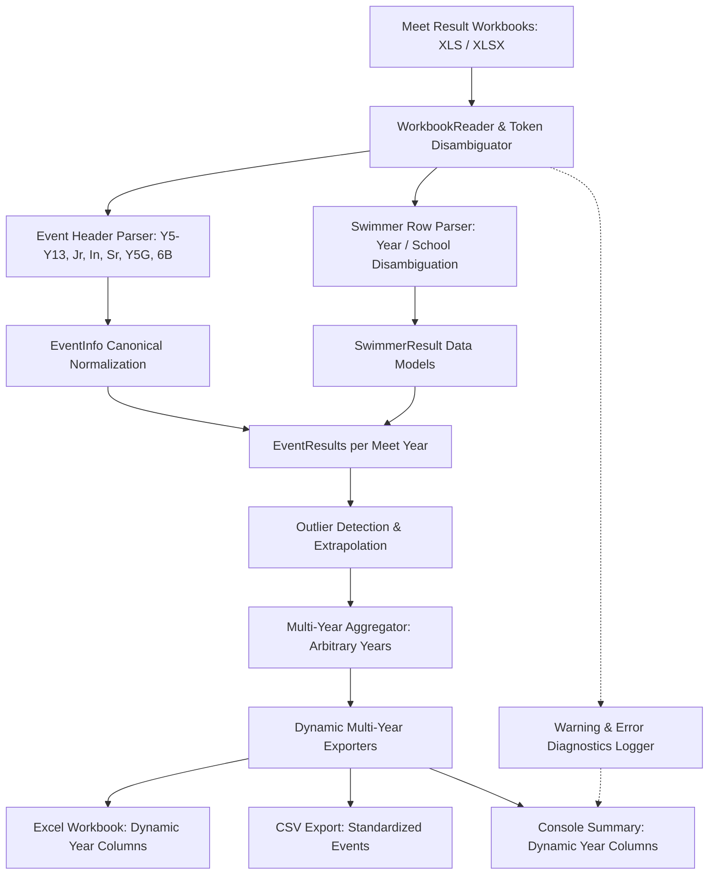

# Requirements

### Overview & Goals
The objective is to extend the regional swimming qualifying standards generator to support a broader range of school years and age divisions (Year 5, Year 6, Year 7, Year 8, and named divisions: Junior, Intermediate, Senior), make the engine calendar year agnostic (handling any years beyond the initial 2024–2026 test files), dynamically report on all supplied years in tabular outputs, disambiguate combined year/gender codes (e.g., `Y5G`, `Y6B`, `5`, `6`, `jr`, `in`, `sr`), and implement robust error reporting throughout the processing pipeline.

### Scope
- **In Scope**:
  - **Extended School Years & Divisions**: Full support for `Y5`, `Y6`, `Y7`, `Y8`, `Y9`–`Y13`, combined bands (`Y5&6`, `Y7&8`), and named divisions (`Junior`, `Intermediate`, `Senior`, `Open`).
  - **Token Disambiguation**: Parsing diverse representations in event titles and swimmer columns: `Y5`, `Y6`, `5`, `6`, `jr`, `in`, `sr`, `jnr`, `int`, `snr`, and combined tokens like `Y5G`, `Y6B`, `5G`, `6B`, `JrG`, `InB`, `SrG`.
  - **Calendar Year Agnosticism**: Removing hardcoded assumptions of 2024, 2025, and 2026. The pipeline will discover, extract, align, and aggregate meet files from any calendar years (e.g. 2021, 2022, 2023, 2028, etc.) and any number of files.
  - **Dynamic Tabular Reporting**: Generating multi-year audit tables in Excel, console summaries, and CSV outputs that dynamically expand to report on all years present in the processed files.
  - **Comprehensive Error Reporting**: Providing clear, actionable diagnostic messages and warnings when file reading, event header parsing, swimmer row extraction, or extrapolation fails.
- **Out of Scope**:
  - Modification of the underlying extrapolation mathematical formulas (`step-average`, `linear-trend`, `percent-increment`).
  - Direct database integrations or external network APIs.

### User Stories
- **As a Meet Director**, I want to generate qualifying standards for Primary, Intermediate, and Secondary age brackets (Y5, Y6, Junior, Intermediate, Senior) from any historical meet archives so that qualifying criteria can be established across all school age divisions.
- **As a System Operator**, I want to supply meet result files from any arbitrary calendar years and receive an Excel audit sheet with dynamic columns for all provided years without modifying the generator code.
- **As an Administrator**, I want clear error and warning diagnostics if a file is corrupted, missing, or contains unparseable event headers so that I immediately know why processing failed and how to fix it.

### Functional Requirements
1. **Year Group & Division Normalization**:
   - Normalize school year strings to canonical forms: `5` / `Y5` -> `Y5`, `6` / `Y6` -> `Y6`, `5&6` / `Y5&6` -> `Y5&6`.
   - Normalize division strings to canonical forms: `jr` / `jnr` / `junior` -> `Junior`, `in` / `int` / `inter` / `intermediate` -> `Intermediate`, `sr` / `snr` / `senior` -> `Senior`.
   - Disambiguate combined tokens: `Y5G` -> Year `Y5`, Gender `Girls`; `Y6B` -> Year `Y6`, Gender `Boys`; `5G` -> Year `Y5`, Gender `Girls`; `JrB` -> Division `Junior`, Gender `Boys`; `InG` -> Division `Intermediate`, Gender `Girls`; `SrB` -> Division `Senior`, Gender `Boys`.
2. **Flexible Event Header Parsing**:
   - Ingest event titles with varied syntax and word ordering (e.g., `Event 5 Y5G 50 SC Meter Freestyle`, `Event 12 Junior Boys 50 SC Meter Backstroke`, `Event 3 50 SC Meter Butterfly Y6B`, `Event 1 Girls 12 & Over 100 SC Meter Breaststroke Y8 Girls`).
   - Extract event number, gender, school year / division, distance, stroke, age group, and relay status.
3. **Swimmer Row Year Column Disambiguation**:
   - Disambiguate 4-token swimmer rows (`[Rank, Name, Token2, Time]`) to determine if `Token2` represents a year group (`5`, `6`, `Y5`, `jr`, `in`, `sr`) or a school name.
4. **Calendar Year Agnosticism**:
   - Detect meet years from filenames containing arbitrary 4-digit years (`(19|20)\d{2}`) or 2-digit patterns, or extract meet years from sheet header titles if filenames lack year stamps.
   - Support arbitrary number of annual input files (e.g., 1, 2, 3, 5, or more years).
   - In default directory scanning, detect all `.xls`/`.xlsx` meet files in the target directory without requiring hardcoded filenames (`results-2024.xls` etc.).
5. **Dynamic Multi-Year Tabular Reporting**:
   - Excel `Audit & Diagnostics` sheet must dynamically construct columns for all distinct years present in the dataset (`{yr} Target Time`, `{yr} Swimmers`, `{yr} Audit Flag`).
   - Console summary table must dynamically generate columns and calculate widths for all supplied years.
   - Primary `Qualifying Standards` sheet and CSV output must format standards for all individual events across all parsed year groups and divisions.
6. **Comprehensive Error Reporting & Diagnostics**:
   - Emit descriptive error messages on `sys.stderr` when input files do not exist, cannot be parsed, or contain no valid events.
   - Record warnings for malformed headers or unparseable swimmer rows, identifying the file, row number, and reason.
   - Support a `--verbose` (`-v`) flag for detailed parsing logs.

### Non-Functional Requirements
- **Backward Compatibility**: Fully retains support for existing Year 7 and Year 8 formats, relay exclusion, and calculation options.
- **Robustness**: Gracefully handles unexpected token ordering, whitespace variations, and missing non-essential metadata.
- **Performance**: Retains sub-second execution across multi-year workbooks with thousands of swimmer rows.

# Technical Design

### Current Implementation
- `swim_standards/models.py`: Defines `EventInfo` (with hardcoded assumptions around `Y7`, `Y8`, `Y7&8`), `SwimmerResult`, `EventResults`, `ExtrapolationResult`, and `AggregatedStandard`.
- `swim_standards/parser.py`: Contains a rigid `EVENT_HEADER_PATTERN` regex matching only `Y[78](?:&[78])?` and strict word ordering; `extract_year_from_filename` checks limited regex; `WorkbookReader` assumes fixed 5/4/3 token layouts without year token disambiguation.
- `swim_standards/aggregator.py`: Aligns events by `canonical_name` and computes statistics across `annual_results`.
- `swim_standards/exporter.py`: Generates Excel and CSV; console summary falls back to hardcoded `[2024, 2025, 2026]` if no years are found.
- `generate_qualifying_standards.py`: CLI entry point with fallback logic tied to hardcoded filenames (`results-2024.xls`, `results-2025.xls`, `results-2026.xls`).

### Key Decisions
1. **Multi-Strategy Token & Regex Normalizer for Event Titles**:
   - *Chosen Approach*: Replace the rigid single regex with a composable token extraction pipeline that extracts event number, distance, stroke, gender, school year/division, and age group independently of token order.
   - *Rationale*: Real meet files vary widely in title structure (e.g., `Event 1 Girls 100 Breast Y8` vs `Event 5 Y5G 50 Free` vs `Event 12 Junior Boys 50 Back`).
2. **Canonical Division and Year Representation**:
   - *Chosen Approach*: Standardize all school years as `Y<N>` (e.g., `Y5`, `Y6`, `Y7`, `Y8`, `Y5&6`) and divisions as TitleCase (`Junior`, `Intermediate`, `Senior`, `Open`). Combined codes (e.g. `Y5G`, `6B`, `JrB`, `InG`) are split into standard `school_year` and `gender` (`Girls`/`Boys`).
   - *Rationale*: Ensures cross-year event alignment in `MultiYearAggregator` matches identical events regardless of whether one meet labeled an event `Y5G` and another labeled it `Y5 Girls`.
3. **Calendar Year Dynamic Extraction**:
   - *Chosen Approach*: Extract 4-digit years from filenames via `\b(19|20)\d{2}\b`, fallback to 2-digit patterns with meet keywords, and scan top sheet header rows if filenames contain no year.
   - *Rationale*: Allows arbitrary past, present, or future calendar years without hardcoded assumptions.
4. **Dynamic Output Table Layout**:
   - *Chosen Approach*: Discover distinct years dynamically from `AggregatedStandard.annual_results` and construct column headers dynamically in openpyxl and console output.
   - *Rationale*: Supports any number of years (1, 2, 3, 5, etc.) cleanly.
5. **Layered Error Reporting with Diagnostic Context**:
   - *Chosen Approach*: Collect parsing warnings per file/row, emit clear fatal errors with non-zero exit codes for unrecoverable issues, and provide `--verbose` output for troubleshooting.
   - *Rationale*: Users can diagnose exactly why a file or row failed to parse.

### Proposed Changes

#### 1. `swim_standards/models.py`
- Update `EventInfo`:
  - `school_year`: Supports `Y1`–`Y13`, combinations (`Y5&6`, `Y7&8`), and named divisions (`Junior`, `Intermediate`, `Senior`, `Open`).
  - `event_order_key`: Expand sort ranking:
    - Distance: numerical (25, 50, 100, 200, ...)
    - Stroke: `Breaststroke` (1), `Backstroke` (2), `Butterfly` (3), `Freestyle` (4), `IM` (5)
    - Gender: `Girls` (1), `Boys` (2), `Mixed` (3)
    - School Year / Division: numerical order for `Y1`–`Y13` (1–13), combined (e.g. `Y5&6` -> 5.5), followed by `Junior` (20), `Intermediate` (21), `Senior` (22), `Open` (23).

#### 2. `swim_standards/parser.py`
- Add normalization functions:
  - `normalize_division_or_year(token: str) -> Optional[Tuple[str, Optional[str]]]`: Extracts `(school_year, gender)` from tokens like `Y5`, `5`, `Y5G`, `6B`, `Jr`, `Junior`, `JrG`, `In`, `Intermediate`, `InB`, `Sr`, `Senior`, `SrG`.
  - `parse_event_header(raw_header: str) -> Optional[EventInfo]`: Flexible multi-token matching extracting event number, distance (`\d+m` or `\d+\s+SC\s+Meter`), stroke, gender, division/year, age group, and relay flag.
- Refactor `WorkbookReader`:
  - Enhance row token classification in `read_file` to disambiguate year tokens from school names in 4-token rows.
  - Add structured warning collection (file, row, raw text, issue description).
- Enhance `extract_year_from_filename(filename: str) -> Optional[int]`:
  - Search for `\b(19\d{2}|20\d{2})\b` across path components; detect 2-digit years with context keywords.

#### 3. `swim_standards/aggregator.py`
- Ensure multi-year grouping handles arbitrary calendar year keys cleanly.
- Maintain chronological sorting for any year keys (`sorted(year_dict.keys())`).

#### 4. `swim_standards/exporter.py`
- `export_to_excel`:
  - Dynamically gather all distinct years present in the dataset.
  - Dynamically generate audit header triplets (`{yr} Target Time`, `{yr} Swimmers`, `{yr} Audit Flag`).
  - Update title and subtitle strings to list all processed calendar years.
- `print_console_summary`:
  - Dynamically format table headers and column widths for any set of calendar years.
  - Suppress hardcoded `[2024, 2025, 2026]` fallback.
- `export_to_csv`:
  - Formats all processed year groups and divisions.

#### 5. `generate_qualifying_standards.py`
- `resolve_input_files`:
  - When `--inputs` is provided: validate paths and provide informative error if any file is missing.
  - When `--input-dir` is provided: scan for all `.xls`/`.xlsx` files.
  - Fallback: scan current directory for any `.xls`/`.xlsx` meet files, sort by extracted year/name, and report a clear error if no files are found.
- Add `--verbose` / `-v` flag to output detailed parsing summaries and row-level warnings.
- Structured error handling: print descriptive error messages to `sys.stderr` and exit with code 1 on failure.

### Architecture Diagram



### Data Models / Contracts

```python

# Canonical Normalization Signatures

def normalize_year_and_gender(token: str) -> Tuple[Optional[str], Optional[str]]:
    """
    Disambiguates school year / division and gender from tokens.
    Examples:
        'Y5G' -> ('Y5', 'Girls')
        '6B' -> ('Y6', 'Boys')
        'JrG' -> ('Junior', 'Girls')
        'In' -> ('Intermediate', None)
        'sr' -> ('Senior', None)
        '5' -> ('Y5', None)
    """

def parse_event_header(raw_header: str) -> Optional[EventInfo]:
    """
    Parses event header strings across diverse token orderings.
    Returns EventInfo with canonical school_year, gender, stroke, distance, and is_relay.
    """

def extract_year_from_filename(filename: str) -> Optional[int]:
    """
    Extracts 4-digit or contextual 2-digit calendar year from path string.
    """
```

### File Structure
```text
.
├── generate_qualifying_standards.py   # CLI entry point, dynamic file resolution, error handling
├── swim_standards/
│   ├── __init__.py
│   ├── models.py                      # Data models with expanded sort keys and division models
│   ├── parser.py                      # Multi-strategy header parser, token disambiguator, calendar year extraction
│   ├── extrapolator.py                # Outlier detection and extrapolation math
│   ├── aggregator.py                  # Multi-year alignment across arbitrary year sets
│   └── exporter.py                    # Dynamic multi-year Excel, CSV, and console formatters
└── tests/
    ├── test_parser.py                 # Tests for Y5-Y13, divisions, combined codes, swimmer token disambiguation
    ├── test_aggregator.py             # Multi-year tests with arbitrary years and variable cohort counts
    ├── test_extrapolator.py           # Outlier detection and extrapolation tests
    └── test_end_to_end.py             # Full pipeline tests, dynamic Excel columns, and error reporting tests
```

### Risks & Mitigations
- **Ambiguous Column Tokens (e.g. `4` tokens where token 2 could be School or Year)**:
  *Risk*: A school with an acronym or short code might be mistaken for a year token, or a numeric year might be mistaken for a school.
  *Mitigation*: The token matcher checks strict patterns for year tokens (`^Y?\d+$`, `^(jr|jnr|junior|in|int|inter|intermediate|sr|snr|senior)$`) and validates that numeric years fall within realistic school year ranges (1–13).
- **Varied Event Header Phrasing across Meet Software**:
  *Risk*: Meet software from different regions uses different word order (e.g. `Y5G 50 Free` vs `50m Freestyle Junior Girls`).
  *Mitigation*: The parser extracts attributes independently using robust keyword/pattern matching rather than relying on a single fixed-order regex.
- **Missing Calendar Year in Filenames**:
  *Risk*: Files named generically like `finals.xls` lack year information.
  *Mitigation*: The parser inspects top sheet header cells for year mentions; if still missing, falls back to sequential meet identifiers and logs a diagnostic warning.

# Testing

### Validation Approach
Verification combines unit testing of parsing rules and token disambiguation, multi-year aggregation tests with arbitrary calendar years, dynamic export layout checks, and end-to-end CLI error handling validation using Python's `unittest` framework.

### Key Scenarios
1. **Year Group & Division Header Parsing**:
   - Verify parsing of numerical years: `Y5`, `Y6`, `Y7`, `Y8`, `5`, `6`, and combined `Y5&6`.
   - Verify parsing of named divisions: `Junior`, `Jr`, `Intermediate`, `Inter`, `In`, `Senior`, `Sr`.
   - Verify parsing of combined tokens: `Y5G`, `Y6B`, `5G`, `6B`, `JrG`, `InB`, `SrG`.
2. **Swimmer Row Disambiguation**:
   - Verify 5-token rows: `[Rank, Name, Yr, School, Time]`.
   - Verify 4-token rows with year: `[Rank, Name, "Y5", "35.20"]` -> `year_group="Y5"`, `school=""`.
   - Verify 4-token rows with school: `[Rank, Name, "St Peters", "35.20"]` -> `year_group=""`, `school="St Peters"`.
3. **Calendar Year Agnosticism**:
   - Ingest files with arbitrary calendar years (e.g. 2021, 2022, 2023, 2027, 2030).
   - Ingest datasets with 1, 2, 4, or 5 years and verify correct aggregation and statistical calculations.
4. **Dynamic Output Generation**:
   - Verify Excel `Audit & Diagnostics` sheet contains exactly the columns for all input years (e.g., if 4 years provided, 12 annual diagnostic columns created).
   - Verify console summary output displays columns matching all input years.
5. **Error Reporting & Diagnostics**:
   - Provide non-existent file path: verify stderr message contains `Input file not found` and exit code is 1.
   - Provide empty directory or directory without spreadsheets: verify informative error message and exit code 1.
   - Provide spreadsheet with corrupt/unparseable data: verify warning diagnostics indicating filename, row, and reason.

### Edge Cases
- **Swimmer with DQ / DNF / SCR / NS / NT**: Correctly flagged as non-finisher and excluded from extrapolation without crashing.
- **Event Contested in Only a Subset of Years**: Aggregator handles missing years gracefully, combining available years and noting missing cohorts in audit diagnostics.
- **Tied Finishing Times in New Divisions**: Correctly preserves tie flags (`*1`, `*8`) for Y5/Y6/Junior/Senior competitors.
- **Combined Year/Gender at Start vs End of Event Title**: Handles `Event 5 Y5G 50 Free` and `Event 5 50 Free Y5G`.

### Test Changes
- `tests/test_parser.py`: Add test cases for `normalize_year_and_gender`, `parse_event_header` with diverse divisions/years/combined tokens, 4-token swimmer rows, and calendar year extraction across arbitrary formats.
- `tests/test_aggregator.py`: Add test cases for multi-year aggregation across non-standard year sets (e.g., 2021, 2022, 2023, 2027).
- `tests/test_end_to_end.py`: Add synthetic end-to-end tests that build multi-year workbooks with Y5, Y6, Junior, Intermediate, Senior events, run the CLI, and verify Excel sheets, CSV rows, and error handling for missing/malformed inputs.

# Delivery Steps

### ✓ Step 1: Implement Comprehensive Year Group, Division, and Combined Token Disambiguation
The system accurately parses and normalizes diverse school years (Y5-Y13, 5, 6), divisions (Junior, Intermediate, Senior, jr, in, sr), and combined year-gender tokens (Y5G, Y6B, JrG, etc.).

- Implement `normalize_year_group` and `normalize_division` helper functions in `swim_standards/parser.py` supporting `Y1`–`Y13`, standalone numbers `1`–`13`, divisions (`Junior`, `Intermediate`, `Senior`, `Open`), and short abbreviations (`jr`, `jnr`, `in`, `int`, `inter`, `sr`, `snr`).
- Implement combined token disambiguation matching patterns like `Y5G`, `Y6B`, `5G`, `6B`, `JrG`, `InB`, `SrG` to extract both year/division and gender.
- Refactor `parse_event_header` in `swim_standards/parser.py` using flexible token and regex parsing to extract event number, distance, stroke, gender, and school year/division regardless of word ordering.
- Update `EventInfo` in `swim_standards/models.py` with an expanded `event_order_key` that establishes consistent sorting across numerical school years (`Y5`–`Y13`), combined years (`Y5&6`, `Y7&8`), and named divisions (`Junior`, `Intermediate`, `Senior`).
- Update `WorkbookReader` swimmer row parsing to distinguish year group tokens from school names in 4-token rows (`[Rank, Name, Yr, Time]` vs `[Rank, Name, School, Time]`).
- Add comprehensive unit tests in `tests/test_parser.py` verifying parsing of all year formats, division aliases, combined tokens, and swimmer row variations.

### ✓ Step 2: Implement Calendar Year Agnostic Extraction and Multi-Year Alignment
The pipeline dynamically handles meet result workbooks from any calendar years and datasets of any length without hardcoded year assumptions.

- Refactor `extract_year_from_filename` in `swim_standards/parser.py` to identify any 4-digit calendar year (`(19|20)\d{2}`) or 2-digit year prefix across filenames and path components.
- Add fallback meet year extraction by scanning sheet title/header rows for year references when filenames lack year metadata.
- Refactor `scan_directory_for_results` and `resolve_input_files` in `generate_qualifying_standards.py` to dynamically discover, deduplicate, and chronologically sort all available `.xls`/`.xlsx` meet files rather than expecting 2024–2026.
- Ensure `MultiYearAggregator` in `swim_standards/aggregator.py` correctly handles arbitrary calendar years (e.g., 2021, 2022, 2023, 2028), variable year counts, and missing annual event occurrences.
- Add unit tests in `tests/test_aggregator.py` verifying multi-year combination behavior across arbitrary years and varying cohort counts.

### ✓ Step 3: Update Tabular Reporting and Dynamic Multi-Year Export Engine
Excel, CSV, and console reports dynamically format and display audit columns and statistics for all calendar years supplied by the input files.

- Update `export_to_excel` in `swim_standards/exporter.py` to dynamically generate multi-year audit columns (`{yr} Target Time`, `{yr} Swimmers`, `{yr} Audit Flag`) for every calendar year present in the dataset.
- Update title and header metadata in `export_to_excel` to reflect the dynamic range of processed meet years.
- Update `print_console_summary` in `swim_standards/exporter.py` to dynamically calculate column widths, table borders, and year headers for all supplied meet years.
- Ensure `export_to_csv` cleanly exports all newly supported school years, divisions, and qualifying standards.
- Add tests verifying Excel workbook generation and console summary formatting across arbitrary multi-year datasets.

### ✓ Step 4: Implement Comprehensive Error Reporting and Diagnostic Logging
Clear, actionable error diagnostics and row-level warning traces are reported whenever file processing, event parsing, or extrapolation encounters issues.

- Add structured warning and error collection to `WorkbookReader` for corrupt files, unparseable headers, invalid swimmer times, or unreadable sheet layouts.
- Enhance error handling in `generate_qualifying_standards.py` to provide user-friendly error messages on `sys.stderr` when files are missing, empty, or fail validation, with appropriate non-zero exit codes.
- Add a `--verbose` (`-v`) flag to the CLI for detailed diagnostic logs showing line-by-line parsing outcomes and skipped non-finisher records.
- Add unit and integration tests in `tests/test_end_to_end.py` verifying descriptive error messages and proper error exits on missing files, malformed sheets, and invalid parameters.